<p align="center">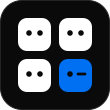</p>

<h1 align="center">YourTeam</h1>

<p align="center"><strong>A multi-agent orchestrator for Claude Code that runs a whole AI software team: CEO, CTO, developers and QA.</strong><br>
You describe the product. The team plans it, builds it phase by phase, and tests every phase, while you watch and steer from a live dashboard.</p>

<p align="center">
  <a href="LICENSE"></a>
  
  
  
</p>

<p align="center">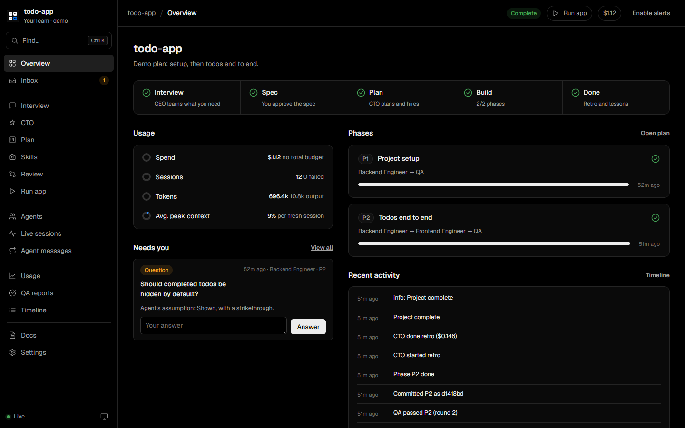</p>

## TL;DR

- **What it is:** a [Claude Code](https://claude.com/claude-code) plugin and skill that orchestrates several AI agents into a software team. A CEO interviews you, a CTO designs the system and hires the team, developers write the code, and QA runs it to check the work.
- **How it works:** a small Node.js orchestrator starts each step of each phase as its **own fresh Claude Code session** (`claude -p`). Agents share knowledge through files (spec, architecture, API contracts, handoff notes), so no agent's context window fills up.
- **Same quality as Claude Code:** every agent is a real Claude Code session, with the same agent harness, tools and models you already use. YourTeam doesn't replace the model or rewrite its output. It only decides who works on what, and when.
- **Built for unattended runs:** phases run one after another on their own. QA failures go back to the agent responsible for a fix, and a run survives restarts. You can also pause before any phase to test it yourself.
- **Try it free:** `--demo` runs the whole pipeline with simulated agents and spends no tokens.

## Contents

- [Why YourTeam](#why-yourteam)
- [Same agent harness as Claude Code](#same-agent-harness-as-claude-code)
- [How it works](#how-it-works)
- [The dashboard](#the-dashboard)
- [Install](#install)
- [Quick start](#quick-start)
- [Features](#features)
- [Skills for agents](#skills-for-agents)
- [Controlling it from Claude Code or another agent](#controlling-it-from-claude-code-or-another-agent)
- [Costs and safety](#costs-and-safety)
- [FAQ](#faq)
- [Development](#development)

## Why YourTeam

One long AI coding session works well for small tasks. For a whole product, it runs into the same problems again and again:

| Problem with one long session | What YourTeam does |
|---|---|
| The context window fills up, and quality drops as the chat grows | Every step is a **fresh session** that starts with only what it needs |
| Requirements are vague, so the agent guesses | A **CEO interview** produces a written spec that you approve |
| No architecture, so the code drifts | A **CTO** writes the architecture, conventions and API contracts first |
| The agent says "done" without running anything | **QA runs the software** and checks each acceptance criterion |
| You have to watch it the whole time | Phases **run unattended**, and failures go back to their owners automatically |
| Hard to see what happened | A **live dashboard** shows every session, diff, message, cost and QA result |

## Same agent harness as Claude Code

YourTeam is an **orchestrator**, not a new coding agent. It doesn't call a model API directly, and it doesn't wrap the model in a different harness.

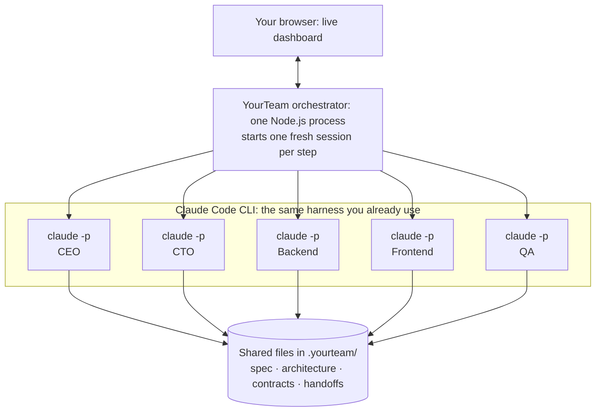

- **Same tools:** agents use Claude Code's own Read, Edit, Write, Bash, Grep and other tools, with Claude Code's permission system.
- **Same models:** Opus for the CEO and CTO and Sonnet for the rest by default. You can change the model per agent.
- **Same project context:** sessions run in your project folder, so Claude Code loads your `CLAUDE.md` as usual.
- **Same sign-in:** sessions use your own Claude Code CLI login. YourTeam never handles API keys.
- **Code quality is unchanged:** the code is written by Claude Code itself. YourTeam adds structure around it (a spec, an architecture, contracts, a QA gate), so code quality is the same, and usually more consistent across a large project.

## How it works

### The pipeline

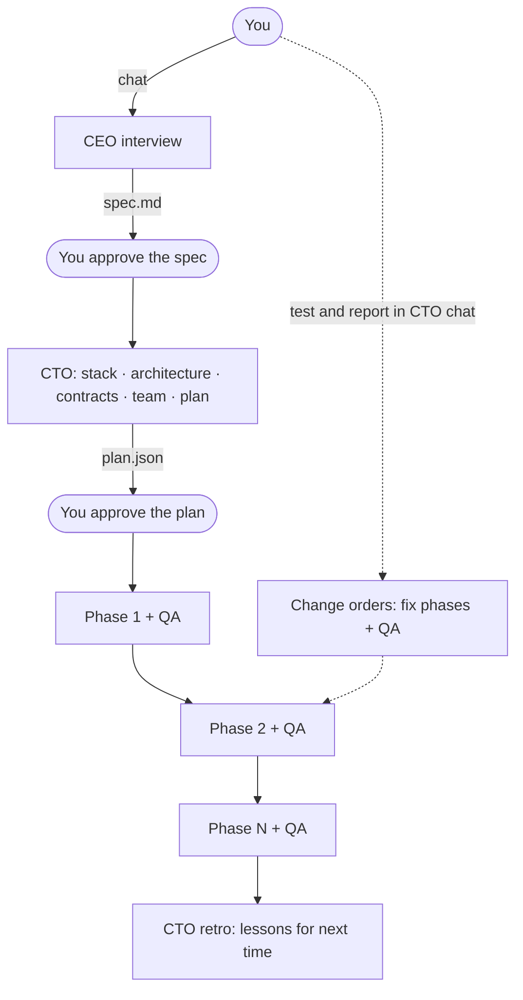

### Inside one phase

Each box below is a **separate, fresh Claude Code session**. Backend runs before frontend, and QA closes every phase.

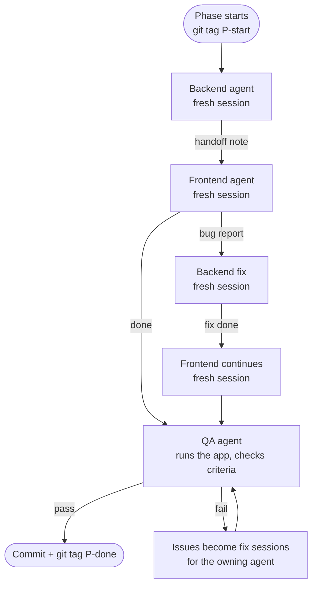

If an agent runs out of room, it writes a handoff and a new session continues the work. If it needs a decision, the question shows up in your Inbox. If QA keeps failing, the team escalates to you instead of looping forever.

### Memory lives in files, not chat history

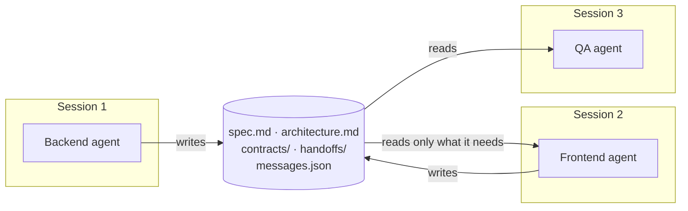

Everything lives in `<project>/.yourteam/`, so a run survives restarts:

| What | Where |
|---|---|
| Spec, architecture, conventions | `spec.md`, `architecture.md`, `conventions.md` |
| API contracts and decisions | `contracts/`, `decisions/` |
| Team and plan | `roster.json`, `agents/*.md`, `plan.json` |
| Each session's output | `handoffs/*.md` (for the next session), `reports/*.json` |
| QA results | `qa/<phase>-r<round>.json/.md` |
| Live state | `state.json`, `sessions.json`, `inbox.json`, `messages.json`, `logs/` |

File formats, the state machine and every setting are documented in [`references/protocol.md`](plugins/yourteam/skills/yourteam/references/protocol.md).

## The dashboard

All screenshots come from a `--demo` run.

### 1. Interview with the CEO

The CEO's replies stream live. Its questions arrive as cards with suggested answers, and a checklist shows how much of the picture is covered.

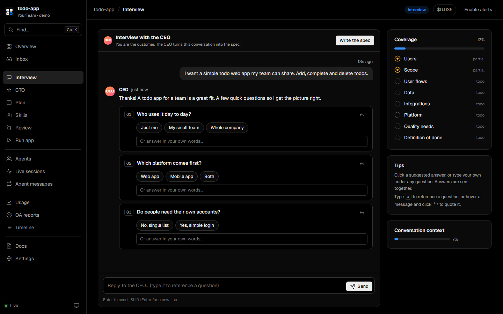

### 2. Plan board

Phases move from Pending to Done. Each phase has an **Auto-run** switch: turn it off and the team waits for you before starting that phase.

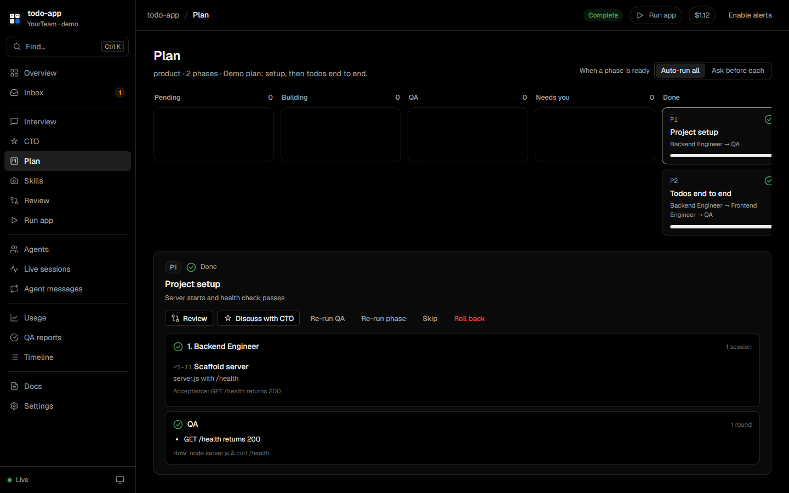

### 3. Phase review

See every file a phase changed, its QA result and the manual test steps. Click **Looks good**, or **Report a problem** to send it to the CTO.

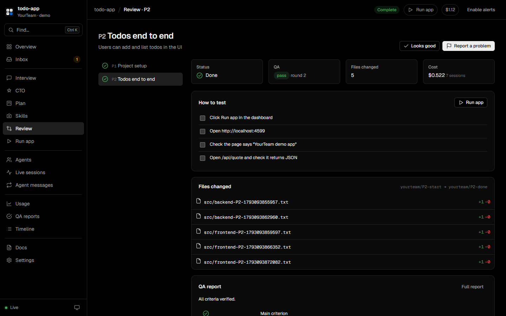

### 4. CTO chat and change orders

Tell the CTO what you found while testing. It works out which agent owns the problem and proposes a change order. Nothing changes until you click **Apply**.

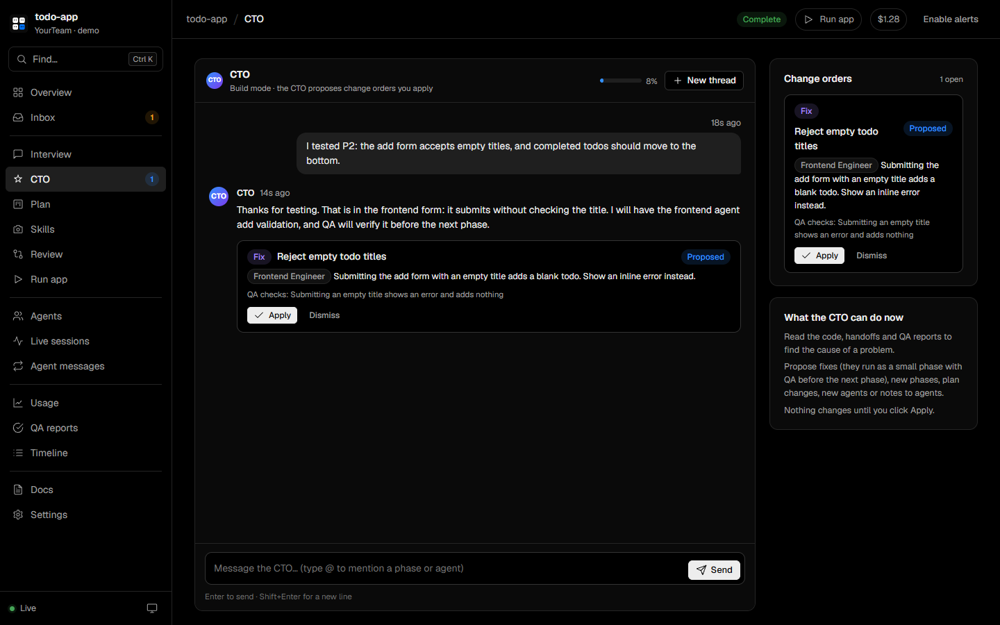

### 5. Usage

Cost, tokens and context-window use per agent, phase and session.

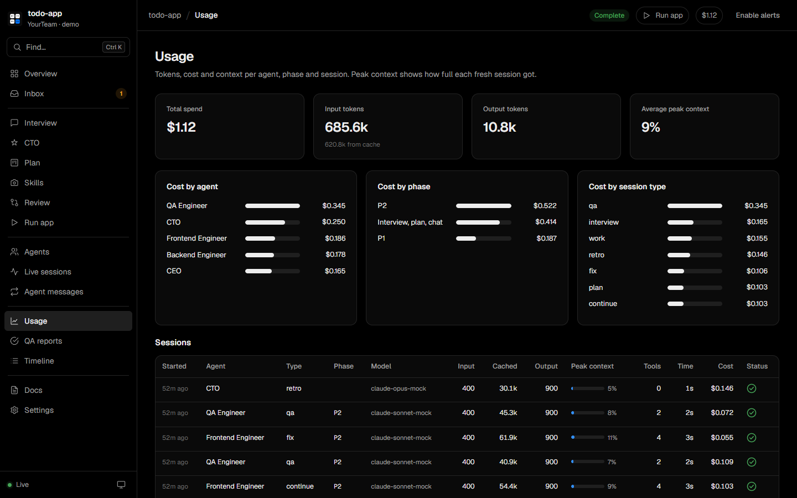

## Install

### Requirements

- [Claude Code](https://claude.com/claude-code), with the `claude` CLI signed in.
- Node.js 18 or newer. There are no npm dependencies.
- Git (optional, recommended). It powers phase checkpoints, review diffs and rollback.

### As a Claude Code plugin (recommended)

```bash
claude plugin marketplace add Adi-Hulan/yourteam
```

```bash
claude plugin install yourteam@yourteam
```

Or inside Claude Code: `/plugin marketplace add Adi-Hulan/yourteam`, then `/plugin install yourteam@yourteam`.

### As a personal skill

Copy `plugins/yourteam/skills/yourteam` to `~/.claude/skills/yourteam`.

### Sign in the CLI once

The orchestrator starts its own `claude` processes, so the CLI needs its own sign-in:

```bash
claude auth login
```

## Quick start

In Claude Code, just ask:

> Use YourTeam to build a small quote-of-the-day web app in ./quotes

Claude checks your setup, starts the orchestrator and opens the dashboard. Then:

1. **Talk to the CEO** in the Interview tab and approve the spec.
2. **Shape the plan** with the CTO and approve it.
3. **Watch the build.** Answer questions in the Inbox, review each phase, and report problems to the CTO.

You can also run it yourself:

```bash
node plugins/yourteam/skills/yourteam/scripts/yourteam.mjs doctor
```

```bash
node plugins/yourteam/skills/yourteam/scripts/yourteam.mjs start ./my-project
```

**Try it without spending tokens:**

```bash
node plugins/yourteam/skills/yourteam/scripts/yourteam.mjs start ./yourteam-demo --demo
```

## Features

- **CEO interview:** questions as cards with suggested answers, a coverage checklist, and a written spec at the end.
- **CTO planning:** the CTO picks the tech stack, writes the architecture, conventions and API contracts, and hires the team from 10 specialist role templates: backend, frontend, fullstack, mobile, devops, database, security, designer, docs and data/ML. It can also write brand-new roles.
- **CTO chat:** during planning, the CTO edits the plan and shows a diff. During the build, it proposes change orders: fix phases with QA, new phases, plan changes, new agents, or notes to agents.
- **Phase by phase:** a per-phase **Auto-run** switch lets you stop before any phase and test what exists so far.
- **Agents talk to each other:** a frontend bug report to the backend triggers a backend fix session, then a fresh frontend session that continues.
- **QA closes every phase:** QA runs the software, checks the acceptance criteria and writes manual test steps. Failures go back to their owners automatically.
- **Review and Run app:** diffs per phase, QA results, test checklists, one-click **Run app** with a console, and rollback to git checkpoints.
- **Full visibility:** an inbox, live session logs, the agent message board, a timeline, and cost, tokens and context-window use.
- **Safe defaults:** budget caps, per-agent tool permissions, retry limits and crash-safe state on disk.
- **Learns over time:** the CTO writes a retrospective, and its lessons feed into future plans.

## Skills for agents

Give agents expert [Claude Code skills](https://docs.claude.com/en/docs/claude-code/skills) from the community. The catalog holds only links, so no third-party code ships with YourTeam.

| Skill | Repository | Good for |
|---|---|---|
| Emil Kowalski: Design Engineering | [emilkowalski/skills](https://github.com/emilkowalski/skills) | UI polish and animation decisions |
| Ponytail | [DietrichGebert/ponytail](https://github.com/DietrichGebert/ponytail) | The smallest change that fully solves the task |
| Impeccable | [pbakaus/impeccable](https://github.com/pbakaus/impeccable) | Frontend design system and design audits |
| Taste Skill | [Leonxlnx/taste-skill](https://github.com/Leonxlnx/taste-skill) | Art direction for landing pages and marketing sites |

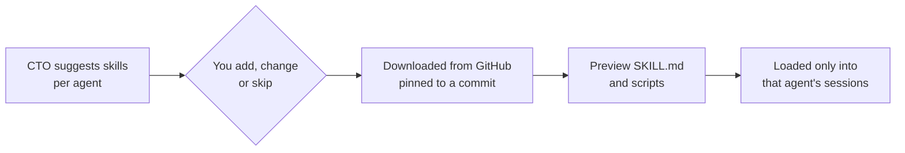

Skills run inside agents that work unattended with shell access, so only add skills from sources you trust. Want a skill in the catalog? Open a pull request that adds it to [`catalog/skills.json`](plugins/yourteam/skills/yourteam/catalog/skills.json).

## Controlling it from Claude Code or another agent

Every dashboard button has a matching command-line action, so Claude Code or any other agent can drive a run:

```bash
node .../yourteam.mjs status ./my-project
```

```bash
node .../yourteam.mjs action cto-chat '{"text":"The add form accepts empty titles"}' --dir ./my-project
```

Actions include `chat`, `brief`, `approve-spec`, `approve-plan`, `start-phase`, `cto-chat`, `apply-change-order`, `pause`, `resume` and `app-start`. The full list is in [`SKILL.md`](plugins/yourteam/skills/yourteam/SKILL.md).

## Costs and safety

- **Cost:** real runs spend real tokens. The defaults are Opus for the CEO and CTO and Sonnet for the rest, with a $10 cap per session. Set a total budget in **Settings**; the team pauses when it's reached.
- **Permissions:** agents run with `acceptEdits` plus only the tools listed for that agent. Anything else is denied automatically rather than prompting. MCP servers are off for agent sessions. The "Skip all permission checks" switch is meant for sandboxes and VMs only.
- **Local only:** the dashboard listens on `127.0.0.1` and rejects requests from other websites.
- **Your git history:** `.yourteam/` is kept out of git through `.git/info/exclude`, so your project's own `.gitignore` isn't touched.

## FAQ

**What is YourTeam?**
YourTeam is an open-source multi-agent orchestrator for Claude Code. It turns Claude Code into a software team (CEO, CTO, developers, QA and any specialists the CTO hires) that builds a product phase by phase, with a browser dashboard to watch and steer the work.

**Does YourTeam change or lower Claude Code's code quality?**
No. Every agent is a real Claude Code session, using the same harness, tools and models. YourTeam only orchestrates: it decides which agent works on what, gives each one a focused prompt, and gates every phase with QA.

**How is this different from Claude Code subagents?**
Subagents run inside one parent session, and their results come back into its context. YourTeam runs each step as a separate top-level Claude Code session, controlled by an external process. Durable state lives on disk, so a run can go for hours unattended, survive restarts, and never fill one context window.

**Can it run unattended?**
Yes. Phases auto-run by default, failures turn into fix sessions, and blocking questions wait in the Inbox. Turn off Auto-run on a phase when you want to test before the team continues.

**Which languages and frameworks does it support?**
Any that Claude Code can work with. The CTO picks the stack for each project, or you can tell it which stack to use.

**How much does it cost?**
It depends on the project size and models. You see the cost of every session live, and you can set a per-session cap and a total budget. `--demo` costs nothing.

**Does it need an API key?**
No. It uses your existing Claude Code CLI sign-in.

**Can I use it on an existing codebase?**
Yes. Point it at an existing folder and describe the feature, refactor or bug fix. The CTO reads the code before planning.

## Development

The self-test runs the full pipeline with the simulated CLI. It covers the interview, the plan, CTO edits, auto-run gates, the fix loop, QA retries, Run app, change orders and the retro.

```bash
node plugins/yourteam/skills/yourteam/scripts/test/selftest.mjs
```

```
.claude-plugin/marketplace.json        marketplace manifest
plugins/yourteam/
  .claude-plugin/plugin.json           plugin manifest
  skills/yourteam/
    SKILL.md                           instructions Claude follows
    references/protocol.md             formats, state machine, config
    catalog/skills.json                skill catalog (links to GitHub only)
    templates/agents/*.md              role templates the CTO hires from
    templates/docs/                    spec and handoff templates
    scripts/yourteam.mjs               CLI: start | status | action | doctor
    scripts/lib/                       orchestrator, prompts, store, runner, git, server, skills
    scripts/dashboard/                 the browser UI (no build step)
    scripts/test/                      simulated CLI and self-test
```

## License

[Apache License 2.0](LICENSE)

<sub>Keywords: multi-agent orchestrator, Claude Code plugin, Claude Code skill, AI software team, autonomous coding agents, AI CTO, AI QA agent, agentic software development, headless claude -p orchestration, AI developer team dashboard.</sub>
